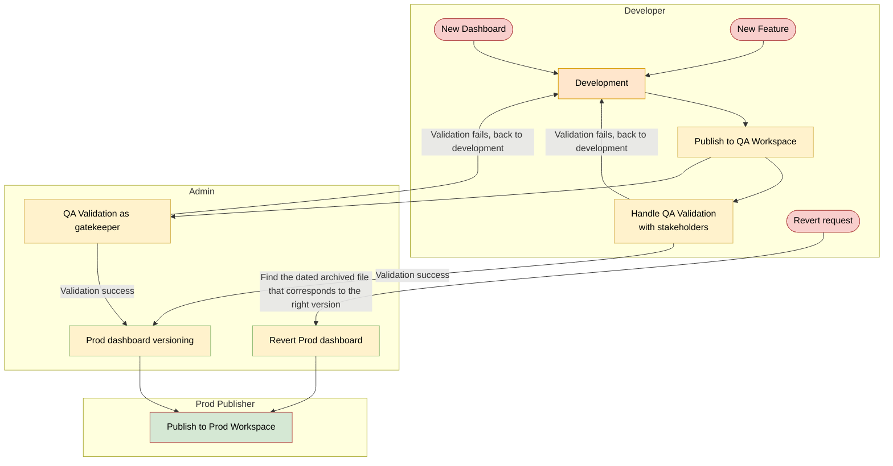

- [Power BI Deployment Process 2026](#power-bi-deployment-process-2026)
- [1.0 Overview](#10-overview)
- [2.0 Objectives](#20-objectives)
- [3.0 Stakeholders](#30-stakeholders)
- [4.0 Architecture](#40-architecture)
- [5.0 Next Steps](#50-next-steps)
- [6.0 Requirements](#60-requirements)
  - [6.1 Power BI Workspaces](#61-power-bi-workspaces)
  - [6.2 SharePoint Folder Structure](#62-sharepoint-folder-structure)
  - [6.3 Versioning Documentation Spreadsheet](#63-versioning-documentation-spreadsheet)
  - [6.4 Roles and Access for PowerBI Workspaces](#64-roles-and-access-for-powerbi-workspaces)
  - [6.5 New Dashboard Workflow](#65-new-dashboard-workflow)
  - [6.6 New Feature Workflow](#66-new-feature-workflow)
  - [6.7 Revert Version Workflow](#67-revert-version-workflow)
- [7.0 References](#70-references)
  - [7.1 Open Questions](#71-open-questions)
- [8.0 Changelog](#80-changelog)
  - [October 21, 2026](#october-21-2026)
  
# Power BI Deployment Process 2026

# 1.0 Overview
This project defines a standard process for developing, validating, versioning, publishing, and reverting Power BI dashboards. The process uses two Power BI workspaces (QA and Prod) and a SharePoint folder structure as the system of record for versioned dashboard files (.pbix).

The process covers three scenarios:
1. Creating a new dashboard
2. Developing a new feature to an existing dashboard
3. Reverting a production dashboard to a previous version

# 2.0 Objectives
We want a stable process from development to production for Power BI dashboards. Specifically, we want to:
1. Separate validation (QA workspace) from production (Prod workspace).
2. Enable convenient QA with stakeholders and admins before a dashboard reaches production.
3. Keep select production dashboard versions archived in SharePoint with a documented changelog.
4. Be able to quickly revert a production dashboard to a previous version.
5. Restrict production publishing to a defined set of publishers.

# 3.0 Stakeholders
1. Developers: Sofie BI Team
2. Admins: Ajay, Tabassum Rahman
3. Prod Publishers: Elangovan Srinivasan
4. Business stakeholders who perform QA validation: All Sofie teams

# 4.0 Architecture
The process is organized into three roles (swimlanes): Developer, Admin, and Prod Publisher.



[Workflow Diagram with more details](https://viewer.diagrams.net/?tags=%7B%7D&lightbox=1&highlight=0000ff&edit=_blank&layers=1&nav=1&title=Power%20BI%20Deployment&dark=auto#R%3Cmxfile%3E%3Cdiagram%20name%3D%22Swimlane%20(Sharepoint)%22%20id%3D%22NUxr8SXDNJHEW0_cDs3a%22%3E3Vxdd6I6F%2F41rnXOhV0QBPGy2tozM505zul0evrezIoQlREJJ8Sq8%2BvfBIJ8pYgols6NNTEkkGd%2FPHtn0442Wm3vCPQXn7GN3A5Q7G1Hu%2BkAAFRVYX94zy7qURVNj3rmxLFFX9Lx4PxC8UDRu3ZsFGQGUoxd6vjZTgt7HrJopg8SgjfZYTPsZlf14RwVOh4s6BZ7nxybLqJeU1eS%2Fr%2BQM1%2FEK6uK%2BGUF48GiI1hAG29SXdptRxsRjGn0bbUdIZfvXrwvM%2B3u47b3YwC7veF2ebO8DX6uutFk42Mu2T8CQR4979Sg4tTiFgK6i%2Fc12DgrF3qsNbQWjmvfwx1e8ykCCq1l3BoSFDCRmMTzq7muz5BLmsJ6F5g4v7BHoSuGsXkIFfIEsiMe%2BBLxdXSVXEHwEo2wiwnrsdEMrl1%2BDzYMFsgWg3hjAilFxAt7gKLyaaLne4HuWjzfBG8QYV3DD%2BzjBvku3q34MwDlj4cFu3cfOx79U1yGCEXblLwJBO4QXiFKdmzIIiVjpiYkapMIpAoGojNWvb5o7xVPtKFQiPl%2B8gR09kXgfoQMaBVlAJTJQAlaZwPKkOF0g16Qi32OVQ0oNKUMCrH14Aw7H%2Fj6p%2F%2F0l9Fj3w36gdr9e%2FZpF2sVsgsm7AAUArIAr4mFSsb1CpDxtR5EExO6wHPsQfc26R0SvPbsEAWOWjLmHmNfQPMTUboTYMM1xVl00dah%2F%2FLLr3TRek79chMrfNjYxQ2P7ee%2F6cZzMgNvJpeFrfg6ITv3cIrcITMK8%2FDuY8maQ38vMkw%2B54iWgKHIpYUgF1LnJQuQEDDlSmtIJ3tHCkICcAIf3%2FHNwqHowYehlGxIuB8pqMTgCSIOu29ERPfMcd14DztAm5kWsqyC3rJfpqbe0zkOzDf6fAn2aMyxczHyU3OK3tQy0QUfvICRA7FoQbO%2FoA03vcwMTDEkdi397hXVO2dn9wxnF1uE0yHt7%2BDn0Y8%2BfXm%2B%2FzYhE0aMvF1sPptTdr09yq5UVPZEv5%2FTv72i7E0qMlAG4HXgw9muCYG71ICQAQSpxSa8I5lU13WZZI1fGQ6MsuHsS7R%2BIoD7Z6svk0K0BPeG01hwlKJolsl0TuRCa5wVE%2Bg6c%2B7GLTZfqP9cjx3G0q%2FFDyvHtiOJ5OxQ3AkHXewym1wfdvQbmaH4zma3GbbY4wECdFwGCtsPZcpZIg83ePwS0YSIwlU0JGUS01WuekADGcR6BwSoAHk3Z3u6am4KPJsFiBZMz3HIlxmLljiY2QzIHYxtTA1dyvv%2Bgh4XGKB8vWYfGRHYOMzW83uGS7Rg8SIiQS3noR90HrraAEmXGjX9jN7D0q0fumME2syj97v%2B9Av9YHeVAtCt9x7vgiqeIgllQLVEc9%2BSGo4RpGuCLkQMVbMp3W4VouPxGIxGpYgW4Lip4VyPA2NPSfaGVm8IjH5tMFLZkANIFOUZ03pi3JekL4zs1pm5ZEZZNkMs9g8ng948dK%2FZbElxtV52NS0HVF5poMsTOpCiIZfG4ERqI0XQLCJYhnQKQbbzNIuUDMisYng4RDytRaIr5rwumtFSxpvxogXZeOCZtYTV2Ek8zIUliCiPwz98gu21FZGgGrIEDqObM4m9M1hEqXIN2mQR67DTyXrqOsEijj5CjvqEyTII76UZG6kVMsZnsJHyTPA52WiZAFyWjRbZX1nolEL7QnRQasV6Z4SijJ1cODC4KMl%2FXQQvgKpcw4y6sIIirO3JFlbc%2BjgNcnkVk2%2BpYApV0mSlaLYoT2bAFdcFbxpEKmFEB3DOC%2Fs651%2BDtWWhIIh%2FYRuX%2BrGyBzuUQuuBQZZRHOSm%2BRRaL5uD66pGdoqzpNBU23%2BE353H5cr0nG5%2F9QPfDGPD2JyKqkV6c1HTm83OqwdMb51jv1pCA%2FpGybHbWVL1vYO5eqNsfDZZX1zNyMqslufRkWSIq464DdXIMb7I0hYmqqEBOzr6Bs1HcPek7CZTG%2F76OgWxBlSxi2Ua1CKzeMHjA6OfOz7oHm381KzxvNzpgVo7AKhq%2B94kAKjLOqvSGu1CLEbK4weNu6u3qTZJuSull8aN6ZhyjnihrmPLHSQ8X3%2F5%2Bq07HA0%2F3tlb%2BrC9fYLdY2htYjkUoPfP7AD7StYB6iLEf83zmIYe177IrzjgAvPraWbOc1V1gWbu1NwAjblAKYLaGbVKusAbh98nV2jInukYh3mKHQRgQK4nY%2Bfzd0h%2Bwo9j0NfujyEtZYi%2FMWkZO57Nt3rBc%2FSMvSDegsRasP3jX2dOmL2nC0jDhyVsDR%2BHGfeI0URXkjDBmMokn4fb6D1TzXIbUJnbnJW9SBGsnTKrqrPFaukW62wb3ZtxQFqOdW%2BqAo72byd4t8Jy2mDQevcmlXjJWdo7qg2%2FtldOzbMwSe1PoS5cKztKPSnjqNauDDeLJqpFuaWi3XgP%2BV8VVKcMpXC2KNFRyPfmU8IXyf8qhlY96bGnEjmtazDNUfXVGLOAb0vOoYvFkZAzwDkjjEuE6r41c%2FgsOl8YeY6q%2BlJT0Q6IbB2Zdk8GkQmmmiEvFSDY7kjrOhxv3hA8hnF%2BeAL369R%2FWn8f7q4fl59eVPOb87%2FK1VRFdN6imkqV7Fy%2BnKqv56ssDhqw91NOJYNQVk5VAnXby6kEJ1TWvothGA7HoTKPipNXO1lDaOYsLCHnmx6G3Da21vwcgF9qLRiuyMXzjijBCnyC2KwLhOiVxMn%2B7eZVnS8ehKE7ygTwJ3ndtJANDgtZA1VdZWHx%2BzXV%2FyC%2B%2BYlkpIDMn6c3YrYH5oWQqvp2yPsx26pSqI77jey2DENDYrdLsH4vdpu%2F1BNkTGXGnkY2mj0yXIXDHBpz3ijhmdfcq6Lq8jEsrloxxmzlZnfSK1%2B9I3ss584SEWk4u1MniyMgEyW1NUMWYEj2PZ%2FQ0ftNGdTKmYJipdjv89bO3n0S9N8aBU29K5L3kl3NaApW0CpYa0Wf2UJ1oWtNl6qbOffYGEDqCYrXViqT37zSl05%2FCyqjSiKHUrjbTmZSvozFkxsvF4rOCF7lg9FQPf29toohuf9SFCwp9ttLS1gz%2BXdZkXAk%2F3VMu%2F0%2F%3C%2Fdiagram%3E%3Cdiagram%20name%3D%22Readme%22%20id%3D%22w9G1d5GFd670AcxV8jgY%22%3EnVZNU9swEP01OZZJ4oQpR0gh9MAMM%2B7Qs2It9hZZ60pyHPrrq5XkOCaQhl7AetovvX3SZpKt6t3aiKZ6IAlqMp%2FK3ST7NpnPZ%2FPFwv9j5DUii8ssAqVBmYwGIMc%2FkMBpQluUYEeGjkg5bMZgQVpD4UaYMIa6sdkzqXHWRpRwBOSFUMfoT5SuiujX5XTA7wHLqs88m6adWvTGCbCVkNQdQNntJFsZIhe%2F6t0KFJPX8xL97j7Y3RdmQLtzHGD57BbiWue%2FHvLl%2Bj6f31xlX2bL4zApsnWvPQkOdn7vpqvQQd6IguHO99tjlauVX838Z3TbCtUmt8n8UrGfbYT236ULRhGTuO2hR0OWu6Wl%2F7sibXsbf5YDsx4l9RZR2CNrdD5GJTieqyA2XFGHuuQMciu044YPCQbf8%2BMbaGifRjBVIExRcbZWFw5Jn0wwIE9gbLCeVmgdmVcWsmhca4BDF5XQZfgSrSMvKPS6VN5o5SHNJWgAGQ5pQhW%2Bi8LxqSUVbe0bKj5RzB0qCLrVniF29ouOWsUJNrxjsW4UcKYt8qlHZPTdk2wJEl0oSeELr5%2Fy%2Fd5ZpTyStbgJ5TgKObZgXL8SmnmSwlYbEobTbvc8og5vQV1HIURWL3xcUbNa9cY2IeP0u45XkstHPitzGpyQCSfNPE%2Bbk4Ukoyi0mmyko4jUkWaUntmgo6FIe3GSBA%2BeEmB%2BUPG%2FdW7%2FW%2Bjv5OGW%2BxRBAA6KSrMamcQXDO%2BMgd8tmgM9xsKuZY3nSvBHFcjH4Viw8y2Mp2oMFWCHlyJcgBpLk0Q%2BFivfDJCnuR6QhyB6ub9z4ajl8UUa5wBhMdIR7qLYYhmvH7e6te8okT1bXgtlaeDMBv0YCAnMy%2BcF8hE4fnnnsTT%2Fmh889GlYrIFqcKHC6mCeZVdpenXD8FteJqwPs0jrNOJ7F5FGb7kPPUwn%2F5EGVL8cBmHYO%2Fg5kd3%2BBQ%3D%3D%3C%2Fdiagram%3E%3Cdiagram%20id%3D%22WjSg_mmf3UEiKUdfxwAN%22%20name%3D%22Swimlane%20(General)%22%3E7Vxdc9o4FP01zOw%2BpONv4DGENLSbZtPQTT9eOsIWtouxiCwC5NevBFKMjGJcgoNIOpMw6CIkWefcq6sjJQ37bDy%2FwGASfUIBTBqWEeI4aNjdhmWZ9JcaJiCEkoHV6McPwmhw6zQOYCZVJAglJJ7IRh%2BlKfSJZAMYo5lcbYiSzWH0fZDADevXOCDRytpyjdzeg3EYiY5Mg38yBqIyN2QRCNBszWSfNyyvYdlz0LA7DWaTf%2BwzjBDZWk1UHs%2FPYMJmVszrqt%2F3uzfw%2BOwYpmRPbZK7jyeTwU3y%2Bbp5%2Fg9Kz26zbnqi6IibMrIQSGSzeJyAlJY6fhQnwSVYoCmrnRHgj0Spg2FGOXMtmjILpk9gTq10aJ0I4fgBpQQkvBptBxNOOEuu0WddiO%2BRsfjGaoz3IJnyMV6jGcTU1PlAX7pwkqDFmI3DMv66gCnEIPmbfwdiAudrj1ptQvNpvYBoDAle0HK0xr%2B2YNssJyulJDfyDgV5F6uix4uAe0b42PRvQU3rcrT3Sw5rkxxlJFIzpgTbCrB24T1M0IRBWyd4dil4HC1Lb7S8imhZG2hhNE0DGHAMZlFMYH8CfPbpjC4cMkS88jXEMX16CszKPIyT5AwlCC%2BbtIctH%2Fr%2BEn6MRnDtk0HLdVyjBOuV29aJtrMJdlv2U7MlQ%2B%2FoDb1pa4X9cGipsQ%2B8ged6Kux7IA0SmlxYxudT%2BnILkjgAJEbpEiaKEhs0GMGIJg0QZ%2FXyw93KD6cp86Pt6s0PPjwYhMXkqiJh0BT7sAID15jFOuvzIsIkQiFKQXKeWzs591g8yOtcIjTh1PoFCVnw1QNMCZL5SMeOF9%2FY99%2B5ovidN7csdOdSacFLPHkFOIRlD%2B89k1MYJpTD9%2FKUcwYZ71pNx3uaNb%2FTrej8FGOwWGtvguKUZLu1lj%2FQNWulsZbCuKpVsSrJK%2FVBe9lXH0unWk3M7yG59MVHMA%2FtwRZ3RL63AgPhZUbVHM1VOuglGNA9oeRUNPSGKX3v0wZZiO%2BwMBvTfdkp%2F2AcB8HKf1l2z4fC3IrzjTbudhpuVxXnpcA%2BBHFC6UknzRiwLJ%2FtJ%2BlLUGceUO6TzaZtSsyz9%2Buhm0wvLCROU%2B4QDYcZJDuw%2F4AE%2FtUDF87P06szH7Xvp1f3C%2FO%2FUOwR9rICXTxMoh%2Bfkrt%2F%2B73TGIPeQ9gmik3IARcgU%2BMF6PA5Shl%2BmqSwO2xfruCMGt5DQKYYHnoDUxAaTH02MMMv6DYZ9VpfRld3g2%2Fh5cf3LXD84N9AhvUK8my1umF4N4XZwbeyzcIKY1raUKGDop%2BOEfasaPTjFnjJr%2F7lh2dQYU102sKDTd9FpGaXNc1NpExPhqrotK0SpHbLPm5Y7piGdMYK%2BpdicI48uEeJjI%2BuODiQUIdKAYEd5mTZcaUsSiYq5M8yxq4xkTKIyIxTEVIOLylaMnc9FnGTSMgTOCSl6biUzWxwfE1KNZiUwsQWEjEm%2BFOMV1r5BKNg6vP0PABZNEAAB%2Bth7YV1lyILhRdpp8spmeHsMelVdnAY1WUek29r77%2Fn%2BS8t5RkvK4iEN0%2BUJZ0mz5r%2FJMpVSaWX1rtzotzNo4tWqbI%2BIUWJalMr9HdQ%2Bq%2BngyTOmKC%2FFHuWcv9XhEfZciwH5kIxyXm8U6ApG1p7XGDKDhVfdoGpGPSbG9x6nauAWs%2FdZ25RNr1aQi%2BOm94m9m5FpGu8l3EajOOadwO2alNavJNha75cWztHaHFes%2FXkVecQbbbesp9a7dXwdj60E%2BzR6NDOS5gGEcT39G1IlrU9MGbZYzrIlqrG1PdhlomadG6lyvuOGGXneSfGO8Oznac58rwjPB6CTgScx3xmVxpaKscq7TYbm5eJAJO9QkDgCMLarxVu33A4QgI%2Bjt2niOd6MCJwYStwVIxoWQPbU28%2FMWJ6pkLbjNPw0GzwtJU3lad2WoWHV0eG4sGdPmRQglxVlqxxU8KlpbqjuvKcorgx8ZrawKW8j6M43CqDVUPflXVE7sraKInFUO7qTYeq3vuHDvsJ5vrQQb3x3PnCuAjvesoWx3hh%2FKhvh4s%2FlNjr9XAhDL5kHzV0Ubzl%2Fow%2BXsstdx4UdhfM%2Ftxyr6KKNV2jNlXskdwSt09EOvT6RLJ27UvlQW75VFzy3rjC33xmwBLs0ShgyXK%2BQvHXS%2BF3HHHMIpbRmiPbiWdL%2FRU7PMbIppT3mnsMbGW3%2Fo91C%2FC0JvpGop%2B5T4bocwel5ruq5iuliPrP%2FozasyP1GfkL3YHO7z1%2FX%2Ftk2x3o50aepxXdt0Irq%2B616TDylH6sso%2BaVcu6W%2F6Xl0i78n%2BRZp%2F%2FDw%3D%3D%3C%2Fdiagram%3E%3Cdiagram%20name%3D%22Swimlane%20(Git)%22%20id%3D%22sE4DEo2-Dg_2edEyL-er%22%3E7V1bc9o4FP41zOw%2B0PEdeAwhaXaadknTaZN96QhbgBvborIcQn%2F9SrYEyHYch2Asksx00kgISfb5zncuOnY65mn48BGDxfwz8mDQMTTvoWOOOoZhaJZO%2F2M9q6yn39Oyjhn2vaxL33Rc%2B38g7xTDEt%2BDsTSQIBQQfyF3uiiKoEukPoAxWsrDpiiQV12AGSx0XLsgKPb%2B8D0y51dha5v%2BC%2BjP5mJlXeOfhEAM5h3xHHhoudVlnnUMp2OYD6BjDjusT%2F5nnmKEyJPDxODw4RQG7OaL%2B9rrd%2B%2FGs%2BT%2BfOyat%2FboyjMHdjfbzPmeZ13fJQwjcvDVjZqr813GZCWkGy%2F9MAARbQ3duR94l2CFEjZFTIB7J1pDDGMKzLGYX891fQYM7nS%2FwznC%2Fh8UERDwYXQeTDiqDXnENVtCfI%2BEm29gdAdPUYAw7fHgFCQB24MH4jn0%2BCDWGANCII5oT59eVD%2B9kezy7kGQ8MsboyXEtGv4D%2F0xgosArUJ2CYb210ef%2FM3HQ0zgwxba6wlnI6KPEIWQ4BVtz7dUodfnwF9u9EbXhV7zBS3e5Owg1ApwrZ2tp34WbOhYjpz9As2sCTSjCmgVkGgWDSN4DwO0YIhoUu5rIZbKfSUMg9KCtmoK2iwIGqMk8taSWc59Aq8XwGWfLqmFlKXLB48h9unVQ8y7p34QCJHTS5r2Xei6BTDQTyZ927K1Clk3K2mrKOiBrN62LHVLbanbSkl9OjXKpe45E8d2yqR%2BASIvoN6SoV2d0B%2FfQeB7gPgoSoVEZcQ2De7gnHpBEMfNoqOEBnLosBwZHqatNDycbHfQK3iMNfGCEuzCp%2FG3hSu21jVvIkzmaIYiEJxteocb5DEe2Iy5RFT7M2D9goSsuMEBCUEyGunW8eqGff%2BDLZq3fLq0MXqQWive4r44wDNYde3WCxGFYUARfC%2FfcY4f7YNumubjmHnOsmLxE4zBamu%2BBfIjEu822%2BaCxmyWbVq0y6xhXYjXWmOwtyVSjcruy%2FMEmSriWpZtq2%2Bvsx0ogonQMa2mFjul2nkJJjTilTSKsu6MOWIunY%2Bx%2B5AxrE9DyhP%2BQeh7Xqa8LIjgO2E6xcFGJ7eHHXtURvESp0%2BBH1Bs0lumTVgwwWJj%2BsPLjH%2Fm6u%2Bb4qsVUuvpuszp%2B1XPAsz1niOt19VzK6LpNIZkB%2FC3iN%2Bb66su0b9FD9fa7xsLaUtDi7p1caqsT%2FoFLmnHOQQkwVAxz9QQaRtFfY9%2BTeG3GnlSCWpGqehPvNCPmhV5vbCzp7aYBzXF3Fc1Ahknk8CPWaCRWqI0DPmB8F2c7qVlnTcNGQ3ddZZZUTgIW%2Fr8kEMA5KmQQy9aiwPEHDVjB90q4KsJ50VV4RsvdFj1Yr67bY%2FVyUyIf09%2FnZF0tANCxk7RJGb%2FxYnrwjgWI%2Bm9lQYf0pntUm%2FWMa2m%2FNc1B%2BUo6Bj91UpqOV5jVkyiAZZbmwEC7yBsPJH%2BtEHLJ9AUz6%2FqddPqB0GEZ8O%2BZ5Uhom9MTKfcvcHIoz3M7Z0ggL1M%2BjEFhx%2FN2kaDox8XGuymnZtBG77NJp8qZVM3ydWX5VMzVn0rLtDhw96djtkzVuCxT%2BPnq4L0qwJdO%2B9WqCbZupGurq4tkENdDgJlgt28NeirDQiB110AsaXrT6ChIMQviDQsKb1EVLpTLSu9Snt3Czu%2BshAymtFbJm%2FPLNmdJe8unzbJIwkEjCCpUzxkuha%2FgtCltici7swWGCmIiAy6MkzKPBOhFLzbpMS7RGQewCmpjMslt%2BUxrkqLwTy0jAIEmKA0uiIDxBSjsMNKFmOSDplgELmM2UDEOG3Bv82%2B4ZPN%2BFx5WXxHmq44ERxXgdbjcoKNnZ1g4fI8meGz2vCC63qzgwJUD%2BXeKlsc4Njyyb3N%2BfYNH90bO5fe1NUSlZWkPR1RgSD7TYu%2BlSxBTdHbb1r0g6ZF30rBXV3T%2BKYPv0RYsvPhl1Gu1q0efkknXSWHYWodflmWuIfCld53TJpzfLqiWGxdyuXIKx7j0djlzb9X1sXZRWhPktFJ8hPZ33rdnY%2F1azv9rRzrH2Mp8VGFBvm6YZtXre21cFhQ7wHXsBpYIlf%2F%2FIIlji%2BIGv80%2F7Uv3R940v9%2B253h%2Fz6dD0X9aB2LWkVaChlU5eqfqdXs2XL9c7dxq5kruNZzCx6j0Sytf96n0awqsD6wzXzwyc3W71uHxbS1MZisIezlY3Z2bYNfZmcHrzPOKJW5UZ8Uq0DZMimOtglPG7Gjg4PznjUwJB5yHpf7XnjPqqTZV8N6ZuOhQiupT0F7G6q73fpkv7T3KwkX4nIAdkVPtjW9nBgfNxBvOgApnE3why6a9Nxfssbxue7l2bC6Sl%2F5hpPjrI3o5V4RYorP32sj2sGiUROLZhGMStZG8GfTqA8Yhj5jTM3zMUVEwNCaxpMldRHTrCNZsEqKtPZXKgpmdRUNv17hmEshfp2PTpLxqfkp%2FP3tajq1nfHEr%2F18axFWijzf%2BhUyWXfWJeEdZvF%2FJzBuIAvxvFpAXcs%2FB6k4Fna3d6oUhxYfFMBwjQvF0GCp8xhkKRrqWhx10aB2qXABED11noYvBcTOQbFAyFZQXGWLjvX47HFOfSNpPZ7TqJPWqwJYy2m9cz8tvyVz2BHuadoEJG1jOuUCpVFFxivZQJyq%2FpYXcuBMoGOIEEE4G%2FuO10S%2B4JiTfaWws5rmtfJ09RHl%2BvbEhcbr5MLSa637VsNXmDvavI25jqf7njxqHItOTftbLMxUOnXE3qmZXlYsh%2F9o2pFjwOx5mpAOZ0Y7Sl%2BItTbs6VS5XNOHZpXo1SWReu9kVy%2BKeye7xrFY8vB6FWZVJ7v3ZwgPxnnp2Cf%2B%2BINA%2B%2BbPbphn%2FwM%3D%3C%2Fdiagram%3E%3C%2Fmxfile%3E)

# 5.0 Next Steps
Implementation steps, in order:
1. Create the QA Power BI workspace.
2. Create the Prod Power BI workspace.
3. Create the SharePoint folder structure.
4. Create the versioning documentation spreadsheet.
5. Create a demo for a new dashboard, a new feature, and a revert to an old dashboard.
   1. Once the demo of the new process is approved, continue with the steps below.
6. Assign access in the QA workspace "Sofie BI (QA)".
   1. Contributor access for all developers.
   2. Owner access for admins and publishers.
7. Assign access in the production workspace "Sofie BI".
   1. Read access for all developers and admins.
   2. Owner access for publishers.
8. Move current SharePoint files to the new SharePoint folder structure.
9. Create or reuse existing Power BI publishing service account.

# 6.0 Requirements

## 6.1 Power BI Workspaces

| Workspace | Purpose |
|---|---|
| Sofie BI (QA) | Developers publish dashboards here for stakeholder validation and admin gatekeeping. |
| Sofie BI (Prod) | Production workspace. Only publishers publish here. |

## 6.2 SharePoint Folder Structure
1. The current process exists in the BI sharepoint under WARP DRIVE > 04 ICB Documentation > 04 Business Intelligence > 01 Dashboards
2. There must be a Prod folder containing the current production version of each dashboard.
3. There must be an Archive folder containing prior production versions of each dashboard. Archived files are dated so that the correct version can be found for a revert.
4. The exact folder hierarchy and naming convention is below
```
--- Syntax ---
BI Dashboard Versioning
├── <## Business Application 1>
│   ├── 01 Production
│   │   ├── PB_<dashboard file A>
│   │   └── PB_<dashboard file B>
│   └── 02 Archive
│   │   ├── AR_<dashboard file A archive version 1>
│   │   └── AR_<dashboard file A archive version 2>
├── <## Business Application 2>
│   ├── 01 Production
│   │   ├── PB_<dashboard file C>
│   │   └── PB_<dashboard file D>
│   └── 02 Archive
│   │   ├── AR_<dashboard file D archive version 1>
│   │   ├── AR_<dashboard file D archive version 2>
│   │   └── AR_<dashboard file D archive version 3>
└── README.md

--- Example ---
Power BI Dashboard Versioning
├── BioRx
│   ├── 01 Production
│   │   ├── PB_Order_Analytics.pbix
│   │   └── PB_Sales_Analytics.pbix
│   └── 02 Archive
│   │   ├── AR_Order_Analytics_20260901.pbix
│   │   └── AR_Order_Analytics_20260921.pbix
├── Salesforce
│   ├── 01 Production
│   │   ├── PB_Account_Analytics.pbix
│   │   └── PB_Task_Analytics.pbix
│   └── 02 Archive
│   │   ├── AR_Account_Analytics_20260601.pbix
│   │   ├── AR_Task_Analytics_20260322.pbix
│   │   ├── AR_Task_Analytics_20260513.pbix
│   │   └── AR_Task_Analytics_20260928.pbix
└── requirements_powerbi_deployment.md
```

## 6.3 Versioning Documentation Spreadsheet
1. The spreadsheet documents the changelog for every production dashboard version.
2. The Admin updates it every time a file is uploaded to the SharePoint Prod folder.
3. Suggested columns (to be confirmed):
   1. Dashboard name
   2. Version / date
   3. Change type (New Dashboard, New Feature, Reversion)
   4. Description of changes
   5. Developer
   6. Admin who versioned it
   7. Publisher who published it
   8. Link to archived file
4. [Example worksheet](https://zevacor365.sharepoint.com/:x:/s/BI/IQD5To9K_a23RK12y2ReCwGWASEg_9bajVuKsjKUQ0Th8Gs?e=hAc8ok)

## 6.4 Roles and Access for PowerBI Workspaces

| Role | Sofie BI (QA) | Sofie BI (Prod) |
|---|---|---|
| Developer | Contributor | Read |
| Admin | Owner | Read |
| Publisher | Owner | Owner |

## 6.5 New Dashboard Workflow
1. **Developer**: 
   1. Builds the new dashboard. 
   2. When development is done, publishes it to the QA workspace.
2. **Developer**: Handles QA validation with stakeholders.
   1. If validation fails, the dashboard goes back to development.
3. **Admin**: (Optional) Performs QA validation as gatekeeper.
   1. If validation fails, the dashboard goes back to development.
4. **Admin**: On validation success, performs Prod dashboard versioning.
   1. Notify the developer and verify all changes are published.  Then downloads the file from the QA workspace.
   2. Uploads the file to the SharePoint Prod folder with the correct file naming convention.
   3. Documents the changelog in the versioning spreadsheet.
5. **Prod Publisher**: Publishes to the Prod workspace.
   1. Downloads the file from SharePoint.
   2. Logs into publishing service account
   3. Publishes from Power BI Desktop.

## 6.6 New Feature Workflow
1. **Developer**: Builds the new feature on an existing dashboard. When development is done, publishes it to the QA workspace.
2. **Developer**: Handles QA validation with stakeholders.
   1. If validation fails, the dashboard goes back to development.
3. **Admin**: (Optional) Performs QA validation as gatekeeper.
   1. If validation fails, the dashboard goes back to development.
4. **Admin**: On validation success, performs Prod dashboard versioning.
   1. Notify the developer and verify all changes are published.  Then downloads the file from the QA workspace.
   2. Uploads the file to the SharePoint Prod folder with the correct file naming convention.
   3. Documents the changelog in the versioning spreadsheet.
5. **Prod Publisher**: Publishes to the Prod workspace.
   1. Downloads the file from SharePoint.
   2. Logs into publishing service account.
   3. Publishes from Power BI Desktop.

## 6.7 Revert Version Workflow
1. A revert version request is raised from the Developer and Stakeholders with approval from upper level management.
2. **Admin**: Finds the dated archived file that corresponds to the right version.
3. **Admin**: Performs Prod dashboard reversion and file management.
   1. Takes the archived dashboard and renames it as the Prod dashboard.
   2. Archives the problematic dashboard.
4. **Prod Publisher**: Publishes to the Prod workspace.
   1. Downloads the file from SharePoint.
   2. Logs into publishing service account.
   3. Publishes from Power BI Desktop.

# 7.0 References

## 7.1 Open Questions
1. Does the Prod workspace keep the name "Sofie BI" for aesthetic purposes?  This is not best practices.

# 8.0 Changelog

## October 21, 2026
1. Initial draft of requirements document.