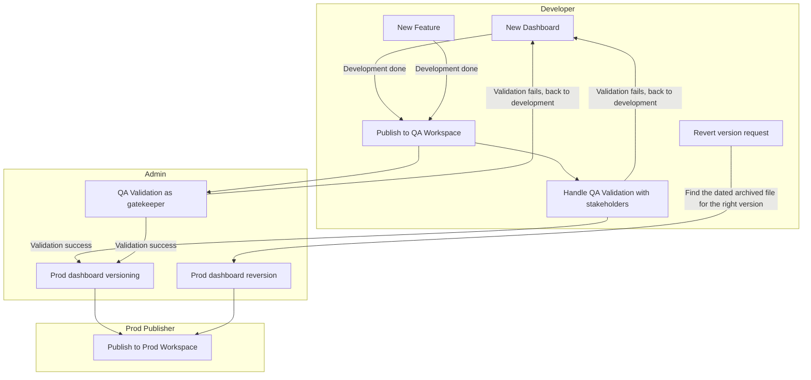

- [Power BI Deployment Process 2026](#power-bi-deployment-process-2026)
- [1.0 Overview](#10-overview)
- [2.0 Objectives](#20-objectives)
- [3.0 Stakeholders](#30-stakeholders)
- [4.0 Architecture](#40-architecture)
- [5.0 Next Steps](#50-next-steps)
- [6.0 Requirements](#60-requirements)
  - [6.1 Workspaces](#61-workspaces)
  - [6.2 SharePoint Folder Structure](#62-sharepoint-folder-structure)
  - [6.3 Versioning Documentation Spreadsheet](#63-versioning-documentation-spreadsheet)
  - [6.4 Roles and Access](#64-roles-and-access)
  - [6.5 New Dashboard Workflow](#65-new-dashboard-workflow)
  - [6.6 New Feature Workflow](#66-new-feature-workflow)
  - [6.7 Revert Version Workflow](#67-revert-version-workflow)
- [7.0 References](#70-references)
  - [7.1 Workflow Diagram](#71-workflow-diagram)
  - [7.2 Open Questions](#72-open-questions)
- [8.0 Changelog](#80-changelog)
  - [October 20, 2026](#october-20-2026)

# Power BI Deployment Process 2026

# 1.0 Overview
This project defines a standard process for developing, validating, versioning, publishing, and reverting Power BI dashboards. The process uses two Power BI workspaces (QA and Prod) and a SharePoint folder structure as the system of record for versioned dashboard files (.pbix).

The process covers three scenarios:
1. Releasing a new dashboard
2. Releasing a new feature to an existing dashboard
3. Reverting a production dashboard to a previous version

# 2.0 Objectives
We want a controlled path from development to production for Power BI dashboards. Specifically, we want to:
1. Separate development validation (QA workspace) from production (Prod workspace).
2. Enable QA validation with stakeholders and admin gatekeeping before any dashboard reaches production.
3. Keep select production dashboard version archived in SharePoint with a documented changelog.
4. Be able to quickly revert a production dashboard to a previous version.
5. Restrict production publishing to a defined set of publishers.

# 3.0 Stakeholders
1. Developers: TBD
2. Admins: TBD
3. Prod Publishers: TBD
4. Business stakeholders who perform QA validation: TBD

# 4.0 Architecture
The process is organized into three roles (swimlanes): Developer, Admin, and Prod Publisher.

[Workflow Diagram](TBD: link to the draw.io diagram "Power BI Deployment (Sharepoint)")

# 5.0 Next Steps
Implementation steps, in order:
1. Create the QA Power BI workspace.
2. Create the Prod Power BI workspace.
3. Create the SharePoint folder structure.
4. Create the versioning documentation spreadsheet.
5. Create a demo for a new dashboard, a new feature, and a revert to an old dashboard.
   1. Once the demo of the new process is approved, continue with the steps below.
6. Assign access in the QA workspace "Sofie BI (QA)".
   1. Contributor access for all developers.
   2. Owner access for admins and publishers.
7. Assign access in the production workspace "Sofie BI".
   1. Read access for all developers and admins.
   2. Owner access for publishers.
8. Move current SharePoint files to the new SharePoint folder structure.

# 6.0 Requirements

## 6.1 Workspaces

| Workspace | Purpose |
|---|---|
| Sofie BI (QA) | Developers publish dashboards here for stakeholder validation and admin gatekeeping. |
| Sofie BI (Prod) | Production workspace. Only publishers publish here. |

## 6.2 SharePoint Folder Structure
1. SharePoint is the system of record for dashboard files.
2. There must be a Prod folder containing the current production version of each dashboard.
3. There must be an archive location containing prior production versions of each dashboard. Archived files are dated so that the correct version can be found for a revert.
4. The exact folder hierarchy and naming convention is TBD (see 7.2 Open Questions).

## 6.3 Versioning Documentation Spreadsheet
1. The spreadsheet documents the changelog for every production dashboard version.
2. The Admin updates it every time a file is uploaded to the SharePoint Prod folder.
3. Suggested columns (to be confirmed):
   1. Dashboard name
   2. Version / date
   3. Change type (New Dashboard, New Feature, Reversion)
   4. Description of changes
   5. Developer
   6. Admin who versioned it
   7. Publisher who published it
   8. Link to archived file

## 6.4 Roles and Access

| Role | Sofie BI (QA) | Sofie BI (Prod) |
|---|---|---|
| Developer | Contributor | Read |
| Admin | Owner | Read |
| Publisher | Owner | Owner |

## 6.5 New Dashboard Workflow
1. **Developer**: Builds the new dashboard. When development is done, publishes it to the QA workspace.
2. **Developer**: Handles QA validation with stakeholders.
   1. If validation fails, the dashboard goes back to development.
3. **Admin**: Performs QA validation as gatekeeper.
   1. If validation fails, the dashboard goes back to development.
4. **Admin**: On validation success, performs Prod dashboard versioning.
   1. Uploads the file to the SharePoint Prod folder.
   2. Documents the changelog in the versioning spreadsheet.
5. **Prod Publisher**: Publishes to the Prod workspace.
   1. Downloads the file from SharePoint.
   2. Publishes from Power BI Desktop.

## 6.6 New Feature Workflow
1. **Developer**: Builds the new feature on an existing dashboard. When development is done, publishes it to the QA workspace.
2. The remaining steps are the same as steps 2 to 5 of the New Dashboard Workflow (6.5). If validation fails, the feature goes back to development.

## 6.7 Revert Version Workflow
1. A revert version request is raised.
2. **Admin**: Finds the dated archived file that corresponds to the right version.
3. **Admin**: Performs Prod dashboard reversion.
   1. Takes the archived dashboard and renames it as the Prod dashboard.
   2. Archives the problematic dashboard.
4. **Prod Publisher**: Publishes to the Prod workspace.
   1. Downloads the file from SharePoint.
   2. Publishes from Power BI Desktop.

# 7.0 References

## 7.1 Workflow Diagram
1. The proposed workflow is documented in the draw.io diagram "Power BI Deployment (Sharepoint)" (see 4.0 Architecture).

## 7.2 Open Questions
1. What is the SharePoint folder hierarchy and naming convention for Prod and archived files?
2. What is the naming convention for dated archive files?
3. Who are the named developers, admins, and publishers?
4. Who is the revert version request raised by, and through what channel?
5. Is the QA validation by the developer with stakeholders and by the admin as gatekeeper performed in parallel or sequentially? The diagram shows both branching from Publish to QA Workspace.
6. Does the Prod workspace keep the name "Sofie BI", with the QA workspace named "Sofie BI (QA)"?

# 8.0 Changelog

## October 20, 2026
1. Initial draft of requirements document.